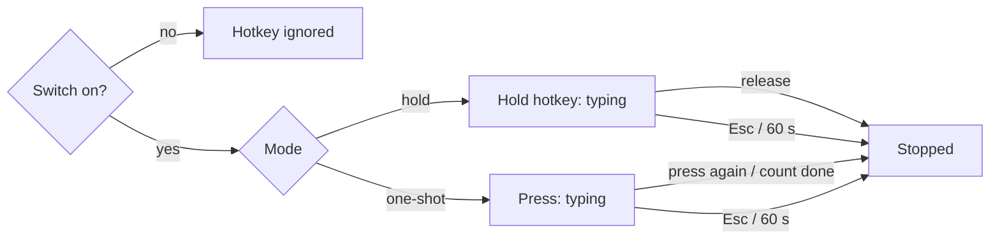

# AutoType — Hotkey, modes and on/off switch (UX)

> Feature master: read this file first to understand how a typing run is triggered. Rules with REQ-IDs live in
> `logic/hotkey.md`. The UI is in Vietnamese; labels are quoted with an English gloss.

## Purpose
- Problem: start and stop a stream of characters from inside any app without leaving it. Audience: the same
  designer/developer. Success signal: hold types, release stops; a wrong combination is easy to diagnose.

## Scope
- Included: the "Bật phím tắt" master switch (window and menu bar), the "Cách kích hoạt" section (mode + hotkey
  recorder), the menu-bar menu, the diagnostic log entries about the hotkey.
- Excluded: what gets typed and how fast (`ux/typing.md`).

## Current truth
- Master switch "Bật phím tắt" (hotkey on) at the top of the window and in the menu-bar menu; off means the keyboard is
  left alone entirely, and switching off mid-run stops the run (AT-KEY-005).
- Mode picker (radio): "Giữ phím tắt thì gõ, thả là dừng" (hold to type, release to stop - default) and "Bấm một phát
  rồi chạy" (press once to run; press again to stop) (AT-KEY-003, AT-KEY-004).
- Hotkey field shows the current combination, default ⌃⌘T (AT-KEY-001). Clicking it shows "Đang chờ… bấm tổ hợp"
  (waiting - press a combination). A combination without a modifier shows "Cần ít nhất một phím bổ trợ" (needs a
  modifier); one with ⌥ shows "Không dùng ⌥ — nó chèn ký tự lạ" (⌥ inserts odd characters). Esc cancels; recording
  gives up after 6 s (AT-KEY-007). The hotkey does nothing while recording (AT-KEY-006).
- The hotkey matches only with exactly the saved modifiers (AT-KEY-002). A near miss (right key, other modifiers) writes
  a line to `~/Library/Logs/AutoType.log` naming both combinations (AT-KEY-008).
- Menu-bar keyboard icon menu: "Mở cửa sổ AutoType" (open window), the master switch, "Thoát AutoType" (quit). Quitting
  is the only way to stop the hotkey besides the switch.
- After the user grants Accessibility in System Settings, the window's warning banner disappears without relaunching
  (AT-KEY-009).

## Screens and states
| Screen | States | Entry | Exit / next |
|---|---|---|---|
| Settings window · "Cách kích hoạt" | idle, recording (6 s max), hint shown | click the hotkey field | valid combination, Esc, timeout |
| Settings window · switch | on (default), off | toggle | toggle |
| Menu-bar menu | open | click the keyboard icon | pick an item |
| Any other app | armed (nothing visible) → typing | hold / press the hotkey | release / press again / Esc / switch off |

## Flow

## Reading order
| File | Role |
|---|---|
| this file | current truth |
| `logic/hotkey.md` | rules + REQ-IDs (AT-KEY) |
| `ux/typing.md` | what a run types and how it ends |

## Change log
- 2026-10-11: created from the v2.2 code and README.
