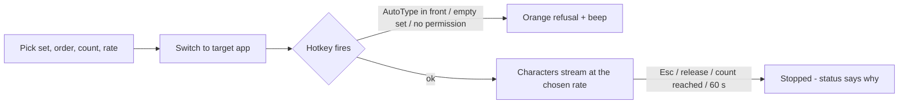

# AutoType — Typing settings and runs (UX)

> Feature master: read this file first to understand what gets typed, how fast, and how a run ends. Rules with REQ-IDs
> live in `logic/typing.md`. The UI is in Vietnamese; labels are quoted with an English gloss.

## Purpose
- Problem: fill a field with many controlled characters without typing them. Audience: designers/developers testing
  fonts and inputs. Success signal: the field receives exactly what was asked for, and the run ends when expected.

## Scope
- Included: the settings window sections "Ký tự sẽ gõ" (characters to type) and "Số lượng" (amount), the status line,
  refusal messages, and how a run ends.
- Excluded: the hotkey, modes and on/off switch (`ux/hotkey.md`); installation and Accessibility onboarding (README).

## Current truth
- One SwiftUI settings window (grouped Form, 380-420 pt wide, scrolls when the screen is short) plus a menu-bar keyboard
  icon. Closing the window does not quit; the hotkey keeps working. Every change is saved immediately.
- Character set picker "Bộ ký tự": Letters (A-Z a-z), Digits (0-9), Letters and digits, Full keyboard (94 characters,
  default), Custom text… - choosing Custom shows a text field (AT-TYPE-001, AT-TYPE-011).
- Toggle "Gõ ngẫu nhiên" (random, default on) with a one-line explanation that switches between "each character picked
  at random" and "in order, wrapping to the start" (AT-TYPE-002).
- "Số lượt" (count, default 100) with an "Vô hạn" (infinite) toggle that disables the count; "Tốc độ" (rate, default 200)
  in characters per second (AT-TYPE-003, AT-TYPE-004). Footer: count applies only to one-shot mode; infinite stops
  after 60 s; above ~1000 chars/s some apps drop characters, keep ≤200 for exactness.
- While running, the status line turns accent-coloured and reads "Đang gõ…"; after a run it states why it stopped and,
  for a release or a finished count, how many characters were typed.
- Esc stops any run (AT-TYPE-007); every run stops after 60 s (AT-TYPE-008).
- If the AutoType window is in front when the hotkey fires, nothing is typed; an orange message with a beep says to
  switch to the target app first (AT-TYPE-009). Empty custom text or a missing Accessibility grant produce the same kind
  of orange refusal (AT-TYPE-010). When Accessibility is missing, an orange banner at the top offers "Mở mục Trợ năng"
  (open the Accessibility pane).

## Screens and states
| Screen | States | Entry | Exit / next |
|---|---|---|---|
| Settings window | idle (status shows the hotkey hint) | launch, menu-bar "Mở cửa sổ AutoType" | close button (app keeps running) |
| Settings window | running (accent status "Đang gõ…") | hotkey in another app | Esc, release, count reached, 60 s, switch off |
| Settings window | refusal (orange message, beep, 6 s) | hotkey while AutoType is in front, empty set, no permission | message clears after 6 s |
| Settings window | permission banner | Accessibility not granted | disappears within ~0.5 s of granting (AT-KEY-009) |
| Target app's field | receives characters | run in progress | run ends |

## Flow

## Reading order
| File | Role |
|---|---|
| this file | current truth |
| `logic/typing.md` | rules + REQ-IDs (AT-TYPE) |
| `ux/hotkey.md` | when a run starts and stops |

## Change log
- 2026-10-11: created from the v2.2 code and README.
